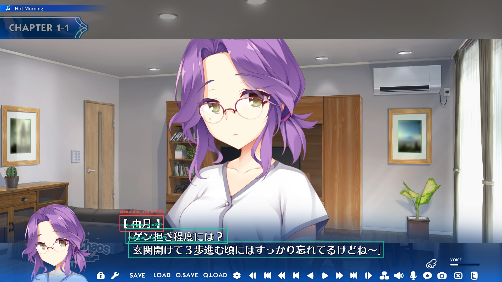

# Visual Novel Text Detector (YOLO26 + EasyOCR)

Real-time UI text region detector and optical character recognition (OCR) pipeline built specifically for visual novels. Powered by **Ultralytics YOLO26n** and **EasyOCR**, this system isolates `character_name`, `choice_box`, and `dialogue_box` containers at **~2 ms per frame** before running OCR—eliminating background artwork noise and improving text extraction speed.



## Key Features
- **3-Class Visual Novel UI Detection**: Accurately distinguishes speaker nameplates (`character_name`), branching prompts (`choice_box`), and main text windows (`dialogue_box`).
- **Low-Latency GPU Inference**: Runs at **1.8 ms inference** per frame (2.39M parameters, 5.4 GFLOPs) on an NVIDIA GeForce RTX 3060 Laptop GPU.
- **Targeted OCR Pipeline**: Crops detected UI containers and sorts them top-to-bottom prior to EasyOCR extraction so character sprites and background scenery never trigger false text reads.
- **End-to-End Dataset Utilities**: Includes helper scripts for automated pre-labeling, Label Studio URL-decoding cleanup, and stratified train/validation splitting.

## Validation Benchmarks

Trained and evaluated on **854 manually verified visual novel screenshots** (683 training / 171 validation) across multiple UI layouts and fonts:

| Class | Precision | Recall | mAP@50 | mAP@50-95 |
| :--- | :---: | :---: | :---: | :---: |
| **All Classes** | **99%** | **93%** | **96%** | **77%** |
| `dialogue_box` | 100% | 99% | 99% | 81% |
| `character_name` | 100% | 90% | 95% | 77% |
| `choice_box` | 98% | 91% | 94% | 72% |

## Repository Structure

```text
visual-novel-text-detector/
├── assets/
│   ├── demo_input.png                  # Sample visual novel screenshot
│   └── demo_output.png                 # Annotated detection visualization
├── weights/
│   └── best.pt                         # Trained YOLO26n weights
├── scripts/
│   ├── auto_labeler.py                 # Automated pre-labeling utility
│   ├── clean_label_studio_labels.py    # URL-decoding cleanup for Label Studio exports
│   ├── split_labels.py                 # Label filtering & splitting helper
│   ├── split_yolo_data.py              # 80/20 train/validation dataset splitter
│   └── generate_demo.py                # Reproducible sample image generator
├── detect_and_ocr.py                   # CLI inference + EasyOCR extraction pipeline
├── train.py                            # YOLO26 model training script
├── requirements.txt                    # Python dependencies
└── README.md

```

## Installation

1. **Clone the repository:**
```bash
git clone [https://github.com/YOUR_USERNAME/visual-novel-text-detector.git](https://github.com/Xreactives/visual-novel-text-detector.git)
cd visual-novel-text-detector
```


2. **Install dependencies:**
```bash
pip install -r requirements.txt
```


*(Note: For CUDA GPU acceleration, install the CUDA-enabled build of PyTorch matching your driver version from [pytorch.org](https://pytorch.org/).)*

## Quickstart: Detection & OCR

Run detection and text extraction on the included sample screenshot using the pre-trained `weights/best.pt` model:

```bash
python detect_and_ocr.py --image assets/demo_input.png --weights weights/best.pt --save assets/demo_output.png
```

### CLI Options

| Flag | Default | Description |
| --- | --- | --- |
| `--image` | `assets/demo_input.png` | Path to the input visual novel screenshot |
| `--weights` | `weights/best.pt` | Path to trained YOLO26 `.pt` weights |
| `--conf` | `0.5` | Confidence threshold for detections |
| `--langs` | `en ja` | Space-separated EasyOCR language codes (e.g., `--langs en ja`) |
| `--save` | `assets/demo_output.png` | Output path for the annotated bounding box image |

### Python Usage Example

```python
import cv2
import easyocr
from ultralytics import YOLO

detector = YOLO("weights/best.pt")
reader = easyocr.Reader(["en", "ja"], gpu=True)

img = cv2.imread("assets/demo_input.png")
results = detector.predict(img, conf=0.5, verbose=False)[0]

for box in sorted(results.boxes, key=lambda b: float(b.xyxy[0][1])):
    label = detector.names[int(box.cls[0])]
    x1, y1, x2, y2 = map(int, box.xyxy[0])
    crop = img[y1:y2, x1:x2]
    text = " ".join(reader.readtext(crop, detail=0, paragraph=True))
    print(f"[{label}]: {text}")
```

## Training From Scratch

1. Format your dataset in YOLO structure with `data.yaml` defining classes `0: character_name`, `1: choice_box`, and `2: dialogue_box`.
2. Run the training pipeline (configured with horizontal flips disabled and reduced mosaic augmentation to preserve UI geometry):
```bash
python train.py
```

## Tech Stack

* **Object Detection**: Ultralytics YOLO26
* **OCR Engine**: EasyOCR
* **Deep Learning & Vision**: PyTorch (CUDA), OpenCV

